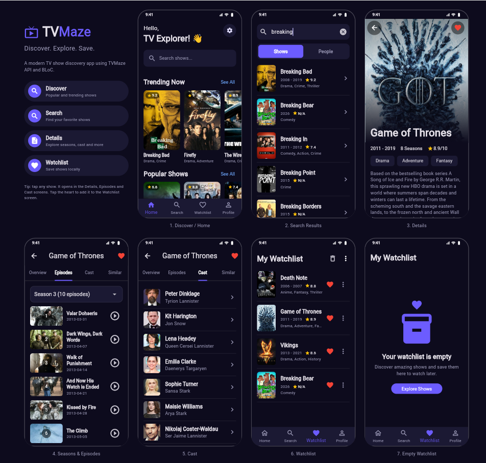
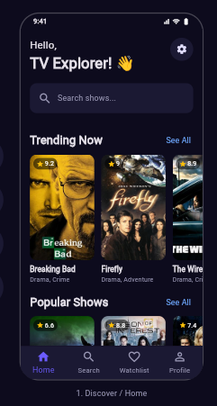
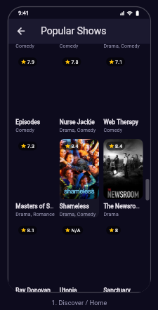
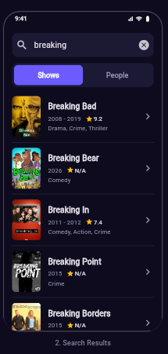
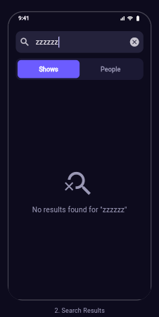
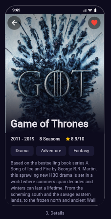
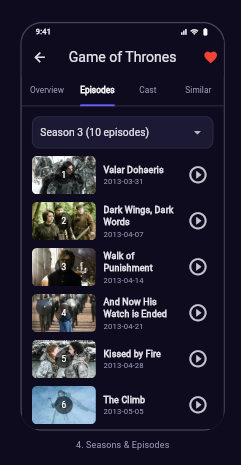
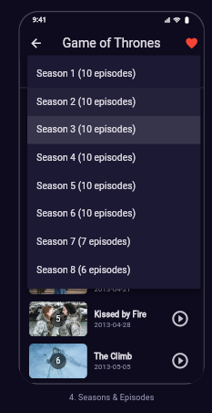
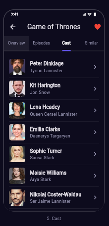
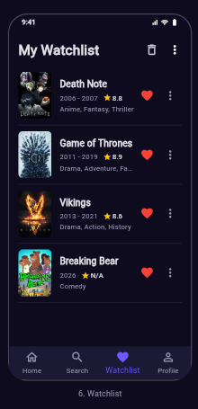

# TV Show Explorer

A Flutter app made with the **BLoC** pattern (`flutter_bloc`) that uses the free [TVMaze API](https://api.tvmaze.com) to browse TV shows, search them, see details and keep a watchlist.

**Name:** Maheen Sodha  
**Roll No:** 23K-0822  
**Course:** CS4039 – Software for Mobile Devices

## Features

- Home with Trending Now and Popular Shows (poster, title, genres, rating)
- Pagination: more shows load when you scroll
- Search shows (and people) with debounce and a "no results" message
- Details: summary, rating, genres, cast, episodes grouped by season, similar shows
- Watchlist: add / remove, saved locally with SharedPreferences
- Loading, empty and error states with a Retry button

## Screenshots

All 7 screens on one page (the last phone is the empty watchlist):



| Home | Pagination (See All) | Search |
|:---:|:---:|:---:|
|  |  |  |

| No results | Details | Episodes by season |
|:---:|:---:|:---:|
|  |  |  |

| Season list | Cast | Watchlist |
|:---:|:---:|:---:|
|  |  |  |

## BLoCs

| BLoC | Events | States |
|---|---|---|
| ShowListBloc | ShowsFetched | Initial, Loading, Loaded, Error |
| SearchBloc | SearchQueryChanged | Initial, Loading, Loaded, PeopleLoaded, Empty, Error |
| DetailsBloc | DetailsRequested | Initial, Loading, Loaded, Error |
| WatchlistBloc | WatchlistStarted, WatchlistToggled, WatchlistCleared, WatchlistSorted | Loading, Loaded, Error |
| SelectedShowBloc | ShowSelected | selected show |

## Project structure

```
lib/
├── main.dart
├── data/          models (Show, CastMember, Episode, Person)
├── domain/        TvMazeApi and WatchlistStorage
└── presentation/
    ├── bloc/      events, states and blocs
    └── ui/        screens and widgets
```

## How to run

1. Install [Flutter](https://docs.flutter.dev/get-started/install)
2. Clone this repository
3. Run `flutter pub get`
4. Run `flutter run -d chrome`

## API endpoints

- `/shows?page=0`
- `/search/shows?q=dark`
- `/search/people?q=bryan`
- `/shows/82`
- `/shows/82/cast`
- `/shows/82/episodes`
